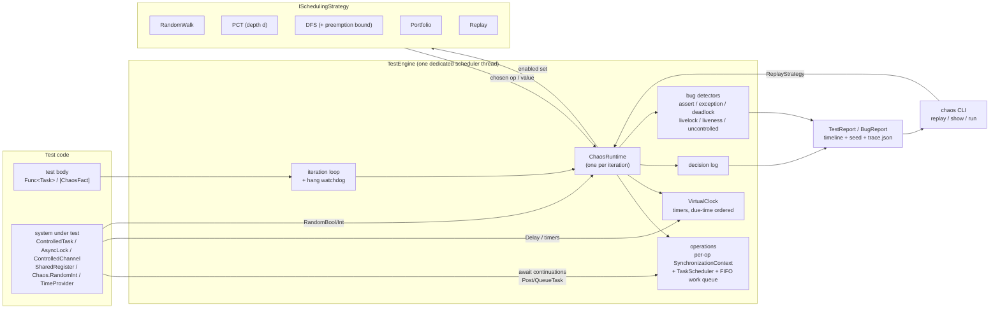
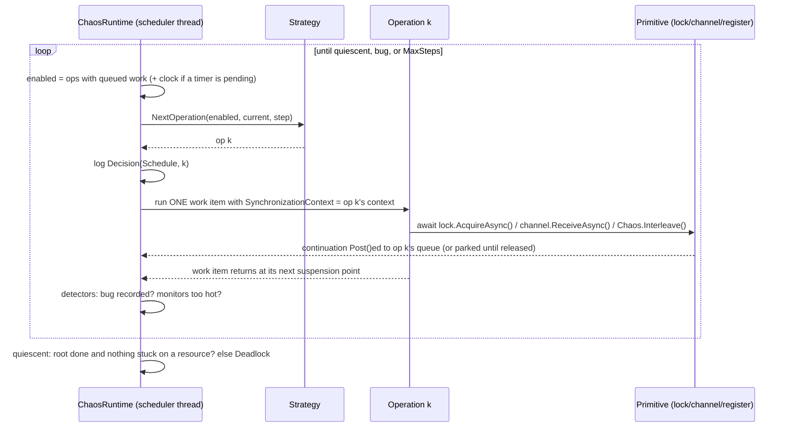

# Chaos.Net

**Systematic concurrency testing for async .NET.** Chaos.Net runs your asynchronous code under a scheduler that it
controls, explores thousands of distinct interleavings (and message-loss, duplication and timing patterns)
deterministically, detects safety and liveness bugs, and hands you a seed plus a schedule trace that replays the
failing execution exactly, every time.

It follows the approach of Microsoft Research's [Coyote](https://github.com/microsoft/coyote) and CHESS, which are used to
test Azure services. It is built from scratch on .NET 10's `SynchronizationContext`/`TaskScheduler`/`TimeProvider`
seams. It does not depend on or copy Coyote.

```csharp
TestReport report = TestEngine.Run(async () =>
{
    var counter = new SharedRegister<int>(0, "counter");
    async Task Increment()
    {
        int v = await counter.ReadAsync();
        await counter.WriteAsync(v + 1);
    }

    await Task.WhenAll(ControlledTask.Run(Increment, "inc1"), ControlledTask.Run(Increment, "inc2"));
    Chaos.Assert(counter.Value == 2, $"lost update: counter = {counter.Value}");
}, new TestConfig { Iterations = 10_000, Strategy = Strategies.Pct(depth: 2, seed: 1) });
```

```text
BUG FOUND | strategy pct(depth=2, seed=0x0000000000000001) | 3 iterations (3 distinct schedules) in 30 ms (102/s) | 24 steps, max 8/iteration

AssertionFailure found in iteration 2 after 8 steps
lost update: counter = 1

Strategy: pct(depth=2, seed=0x0000000000000001)
Iteration seed: 0xa96f0f6526bc7588
Reproduce: new TestConfig { Iterations = 1, Strategy = Strategies.Pct(depth: 2, seed: 0xa96f0f6526bc7588, stepsEstimate: 4) }
Replay: verified (trace re-executed and reproduced the bug on the identical schedule)
Schedule: 0 2*2 1*3 2 0

Operations:
  op0   root  (steps 0..8)
  op1   inc1  (steps 1..6)
  op2   inc2  (steps 1..7)

 step | op0  op1  op2 | events
------+---------------+-------
    1 |  #            | spawn op1 'inc1'; spawn op2 'inc2'
    2 |  :    :    #  |
    3 |  :    :    #  | read counter = 0
    4 |  :    #    :  |
    5 |  :    #    :  | read counter = 0
    6 |  :    #    :  | write counter := 1; op1 'inc1' completed
    7 |  :         #  | write counter := 1; op2 'inc2' completed
    8 |  #            | BUG (AssertionFailure): lost update: counter = 1; op0 'root' faulted
```

---

## Contents

1. [Motivation](#motivation)
2. [Architecture](#architecture)
3. [How controlled scheduling works](#how-controlled-scheduling-works)
4. [What is not controlled (limits)](#what-is-not-controlled)
5. [Exploration strategies](#exploration-strategies)
6. [Bug detection](#bug-detection)
7. [Deterministic replay](#deterministic-replay)
8. [Sample systems](#sample-systems)
9. [Evaluation](#evaluation)
10. [Usage](#usage)
11. [Project layout, build and test](#project-layout-build-and-test)
12. [Roadmap](#roadmap)
13. [References](#references)

---

## Motivation

Cloud services are mostly asynchronous message handling: request handlers, background loops, timers, retries,
leases, replication. Their worst bugs are *interleaving* bugs. Two handlers race on a read-modify-write. A lease
expires during a GC pause. A duplicated message is counted twice. A producer blocks on a full queue while holding the
lock its consumer needs. Such bugs show up rarely in production, almost never on a developer machine, and when stress
testing does trip one, it usually cannot be reproduced.

The OS and the thread pool decide the interleaving, and nobody records the decision. **Systematic concurrency testing**
takes that decision away from the OS:

* The code under test runs in a controlled environment where **every point at which another task could run is a
  scheduling point owned by the framework**.
* A **strategy** decides which pending piece of work runs next. Different strategies explore the space of interleavings
  differently (random, prioritized, exhaustive).
* Every decision is **logged**, so any execution, and in particular any failing one, can be **replayed exactly**.
* Time and randomness are virtualized too, so timeouts, retries and fault injection are explored and replayed just like
  thread interleavings, and a test that "waits" an hour finishes in milliseconds.

## Architecture



One scheduling step, in detail:



## How controlled scheduling works

**Operations.** The test body is operation 0. Each `ControlledTask.Run(work, label)` creates a new *operation*: a
logical thread of asynchronous execution. Ids are assigned in creation order, so they are identical across replays.

**Capturing every continuation.** Every operation owns a custom `SynchronizationContext` and a custom `TaskScheduler`.
While one of its work items runs, `SynchronizationContext.Current` is the operation's context, and
`TaskScheduler.Current` is the operation's scheduler, because every work item is itself a `Task` executed on that scheduler. Consequently:

* `await x` captures the operation's context. When `x` completes, the continuation is `Post`ed into the operation's
  queue instead of running on the thread pool.
* `await Task.Yield()` posts to the context, and is therefore a scheduling point.
* `Task.Factory.StartNew(...)`/`ContinueWith(...)` without an explicit scheduler use `TaskScheduler.Current` and
  are queued to the operation.
* `async void` exceptions are posted to the context and caught as bugs.

**One work item = one atomic step.** All operations run on a *single* dedicated scheduler thread. At each step the
runtime computes the *enabled set* (operations with queued work, plus the clock pseudo-operation if a timer is pending),
asks the strategy to pick one, logs the decision, and runs exactly one work item of that operation. The item runs until the code
reaches an `await` that actually suspends. Code between two suspension points is therefore atomic, and the scheduling
points are precisely:

| Scheduling point | Notes |
|---|---|
| start of every `ControlledTask.Run` operation | spawn does not preempt the parent |
| `await Chaos.Interleave()` / `ControlledTask.Yield()` / `Task.Yield()` | explicit points, e.g. between a read and a write |
| `AsyncLock.AcquireAsync`, `ControlledSemaphore.WaitAsync` | point *before* the attempt, then blocks if unavailable |
| `ControlledChannel.SendAsync` / `ReceiveAsync` | point before; blocks on full/empty |
| `SharedRegister.ReadAsync` / `WriteAsync` / `CompareExchangeAsync` / `UpdateAsync` | each access is preemptible |
| any `await` of something not yet complete | e.g. awaiting another operation |
| virtual timers firing (`ControlledTask.Delay`, `Chaos.TimeProvider`) | the clock is a schedulable pseudo-operation |

An `await` on an already-completed task does **not** yield, exactly as in production. The async-cache sample shows why
this matters: a database read followed by a cache fill only races if the model puts a scheduling point between them,
here the network latency of the response (`ControlledTask.Yield()`).

**Blocking without threads.** Controlled primitives block by parking a `TaskCompletionSource` and registering a
*wait record* (for example "op2 blocked on AsyncLock 'L1' held by op1"). Release hands ownership to the first waiter and
completes its TCS, which posts the waiter's continuation to the waiter's queue. Nothing ever blocks the scheduler thread.

**Virtual time.** `ControlledTask.Delay`, and any API built on `TimeProvider` (`Task.Delay(t, tp)`, `PeriodicTimer`,
`CancellationTokenSource(t, tp)`), schedule timers on a `VirtualClock`. Firing the next timer is a choice offered to
the strategy as the clock pseudo-operation. Timers fire in due-time order and time never goes backwards. Two policies
are available:

* `TimerPolicy.Nondeterministic` (default). The clock competes with ready work, so the scheduler can "pause" an
  operation while time advances. That is how the lease sample finds a GC-pause-longer-than-the-TTL bug.
* `TimerPolicy.FireWhenIdle`. Timers fire only when nothing else can run, which models an infinitely fast machine.

**Controlled nondeterminism.** `Chaos.RandomBool()` and `Chaos.RandomInt(n)` are resolved by the strategy and logged.
Random strategies sample them, DFS branches on them, and replay restores them. Fault injection (drop, duplicate,
fail) is written as ordinary code on top of them.

**Dual mode.** Outside `TestEngine` every API falls back to its production implementation: `ControlledTask.Run` is
`Task.Run`, `AsyncLock` is `SemaphoreSlim`, `ControlledChannel` is `System.Threading.Channels`,
`Chaos.TimeProvider` is `TimeProvider.System`, and `Chaos.Interleave()` completes synchronously. The code you test is the code you ship,
and the naive stress baseline in this repo runs exactly that production path.

## What is not controlled

Chaos.Net controls what flows through its seams. The honest list of what does not:

| Construct | What happens | How Chaos.Net tells you |
|---|---|---|
| `Task.Run`, `ThreadPool.QueueUserWorkItem`, `new Thread`, `System.Threading.Timer`, `Parallel.*` | runs on real threads, uncontrolled | Chaos APIs called from a foreign thread are detected (an `AsyncLocal` flows into the escaped work, but the `[ThreadStatic]` scheduler marker does not), and continuations posted back from a foreign thread are detected. Both are reported as `UncontrolledConcurrency`. Analyzer **CHAOS001**. |
| `ConfigureAwait(false)` | the continuation is not posted to the operation's context, and since the scheduler thread has a non-default context the TPL refuses to inline it, so it runs **on the thread pool** | detected as above; analyzer **CHAOS003** |
| `Task.Delay` without a `TimeProvider`, real I/O | completes on a timer/IO thread, in real time | detected when the continuation is posted back. A quiescent state with no controlled waits triggers a 200 ms probe before a deadlock is reported, so the report says *uncontrolled* rather than *deadlock*. Set `UncontrolledGracePeriod` and `UncontrolledConcurrency = Tolerate` to accept it (nondeterministically). Analyzer **CHAOS002**. |
| `.Result`, `.Wait()`, `GetAwaiter().GetResult()`, `Thread.Sleep`, `Monitor.Wait`, `SemaphoreSlim.Wait` | blocks the single scheduler thread | per-iteration wall-clock watchdog reports a `Hang`. Analyzers **CHAOS004/005**. |
| `TaskCompletionSource(RunContinuationsAsynchronously)` feeding `Task.WhenAll`/`WhenAny` | the TPL's internal combinator continuation is queued to the thread pool | detected as uncontrolled concurrency |
| `DateTime.UtcNow`, `Random`, `Environment.TickCount`, `Guid` ordering, hash-order of `Dictionary<object,…>` | nondeterministic across replays | replay verification fails (`ReplayVerified = false`) or a `Nondeterminism` bug is raised when a replay diverges. Analyzer **CHAOS006**. |
| Synchronous code between awaits | atomic: there is no preemption inside a work item | by design. Insert `await Chaos.Interleave()` or use `SharedRegister` where a data race matters. |
| Weak memory / CPU reordering | not modeled: explored executions are sequentially consistent interleavings | out of scope |
| State shared across iterations (statics, captured objects) | iterations are not isolated by the runtime | Chaos.Net primitives reset themselves per iteration. Your own state must be created inside the test body, and replay verification catches violations. |
| Timer callbacks run with `TaskScheduler.Default` as `TaskScheduler.Current` | `StartNew` inside a `TimeProvider` timer callback escapes | detected as uncontrolled concurrency |

A plain C# `lock` statement is fine: its body cannot contain `await`, so under test it stays inside one atomic step
and never blocks. In production it provides the atomicity the model assumes. The checkpoint sample uses it for
exactly that reason, and the analyzer deliberately does not flag it.

The Roslyn analyzer (`src/Chaos.Net.Analyzers`, rules CHAOS001 to CHAOS006) flags these constructs at compile time in code
under test. The samples project uses it, with two justified suppressions.

## Exploration strategies

All strategies implement `ISchedulingStrategy`: given the enabled operations, pick one, and resolve
`RandomBool`/`RandomInt`. A strategy is a deterministic function of its seed and the calls it receives, which is what
makes executions replayable.

### Random walk

At every step, pick an enabled operation uniformly at random. It is fair with probability 1, very effective on
shallow bugs that need a couple of context switches close together, and weak on bugs that need one operation to be
**starved for a long stretch**. Not scheduling an operation for `k` consecutive steps has probability about
`(1 − 1/n)^k`, which is exponential in `k`.

### PCT: Probabilistic Concurrency Testing

From Burckhardt, Kothari, Musuvathi and Nagarakatte (ASPLOS 2010). A bug's **depth `d`** is the number of ordering
constraints between events that suffice to trigger it. An ordering violation has depth 1, a typical atomicity violation
has depth 2, and the checkpoint sample has depth 3. The algorithm:

1. Give each operation a distinct random initial priority from `d, d+1, …, d+n−1`.
2. Pick `d − 1` **priority change points** `k₁ … k_{d−1}` uniformly at random from `[1, k]`.
3. Always run the highest-priority enabled operation.
4. When the execution reaches step `kᵢ`, lower the priority of the operation about to run to `i`, below every initial
   priority.

**Guarantee.** For a program with at most `n` operations and `k` steps, each PCT iteration finds any bug of depth `d`
with probability **at least `1 / (n · k^(d−1))`**. Crucially, the bound is independent of how many other
interleavings exist. A depth-3 bug in a run of 50 steps with 4 operations is found with probability ≥ 1/10,000 per
iteration, and in practice far more often. PCT deliberately lets one operation run for long stretches, which is exactly
what random walk cannot do.

Implementation details (`src/Chaos.Net/Scheduling/PctStrategy.cs`):

* `k` is not known up front. It is estimated as the maximum number of **choice points** (steps with ≥ 2 enabled
  operations) seen in earlier iterations, or passed as `stepsEstimate`. Only choice points advance the change-point
  counter, so change points are never wasted on forced steps.
* Operations created dynamically get a random position among the non-demoted operations.
* PCT is unfair (a spinning high-priority operation starves the rest), so after `MaxUnfairSteps` (default
  `MaxSteps/2`) the runtime switches the rest of that iteration to a seeded fair random walk. This prevents spin-wait
  loops from being misreported as livelocks. A test covers it.

### DFS: bounded exhaustive search

Stateless depth-first search over the tree of all choices (scheduling and nondeterministic), in the style of VeriSoft and
CHESS. Each iteration replays the current prefix and extends it with first alternatives. Afterwards the deepest choice
point with an untried alternative is advanced. When the tree is exhausted, `report.SearchExhausted` is true and
**every distinct execution has been run exactly once**. The tests check the exact counts: two workers with `s` steps
each give `C(2s, s)` executions, and three workers with 2, 3 and 2 steps give `7!/(2!·3!·2!) = 210`.

* `maxDepth` bounds the number of choice points per execution.
* `preemptionBound` implements **iterative context bounding** (Musuvathi and Qadeer, PLDI 2007). An execution may preempt a
  still-enabled operation at most `p` times. Most real bugs need very few preemptions, and with `p = 2` the
  depth-3 checkpoint bug is found in a few hundred executions. The test suite checks the closed forms: 2 executions for
  `p = 0` and `2s` for `p = 1`.
* DFS verifies determinism as it goes. If a replayed prefix offers a different number of alternatives, it raises
  `Nondeterminism`.

### Portfolio and Replay

`Strategies.Portfolio(a, b, …)` round-robins strategies per iteration, which is the default for `[ChaosFact]` (random + PCT).
`Strategies.Replay(trace)` follows a recorded decision sequence and reports divergence.

## Bug detection

| Bug kind | Detected when |
|---|---|
| `AssertionFailure` | `Chaos.Assert` / `Chaos.Fail` / a monitor assertion fails. The bug is recorded **before** the exception is thrown, so the iteration fails even if the code under test swallows the exception. |
| `UnhandledException` | the test body faults; a background operation faults (default: any exception except cancellation, even if never awaited); an `async void` method throws; a timer callback throws |
| `Deadlock` | no operation is enabled and no timer is pending, **and** either the test body has not completed or some operation is still blocked on a *resource* (lock, semaphore, full channel). The message lists every blocked operation and what it waits on (with the lock holder). Operations idle on a channel *receive* after the body completes are not deadlocks: idle server loops are normal. |
| `Livelock` | `MaxSteps` scheduling steps elapsed while the test body is still running |
| `LivenessViolation` | a `ChaosMonitor` is **hot** at the end of the execution, at the step bound, or for more than `LivenessTemperatureThreshold` consecutive steps (hot/cold monitors in the style of P and Coyote) |
| `UncontrolledConcurrency` | work escaped the scheduler (see [limits](#what-is-not-controlled)) |
| `Nondeterminism` | a replay or a DFS prefix diverged |
| `Hang` | an iteration exceeded `IterationTimeout` of wall-clock time: something blocked the scheduler thread |

```csharp
sealed class RequestMonitor : ChaosMonitor
{
    public void Requested() => Hot("request pending");
    public void Served() => Cold();
}
// in the system under test:
Chaos.Monitor<RequestMonitor>().Requested();
```

## Deterministic replay

Every iteration records a **decision log**: which operation ran at each step (or `t` for the clock), and every
boolean/integer choice. Operation ids are assigned in creation order, the enabled set is ordered by id, timers break
ties by creation sequence, and the PRNG is a pinned xoshiro256** (not `System.Random`, whose seeded sequence is not
guaranteed across .NET versions). The decision log therefore **fully determines** the execution.

When an iteration fails, the engine:

1. builds a `ScheduleTrace` with the decisions in a compact run-length text encoding (`0 2*3 1*3 3*7 2*2 1*2 0`), the
   behaviour-relevant settings, the iteration seed, and a reproduction expression;
2. **re-executes the trace with full event recording** and checks that the same bug occurs on the identical decision
   sequence (`ReplayVerified`). That run also produces the timeline;
3. optionally writes the trace to `TraceDirectory`.

A real trace, written by `chaos run` for the depth-3 test (timeline elided):

```json
{
  "format": "chaos-trace/1",
  "testName": "ChaosNet.Tests.ChaosFactTests.Depth3_checkpoint_bug_is_found",
  "assemblyName": "Chaos.Net.Tests",
  "assemblyPath": "…/tests/Chaos.Net.Tests/bin/Debug/net10.0/Chaos.Net.Tests.dll",
  "strategy": "pct(depth=3, seed=0x0000000000000005)",
  "reproduction": "Strategies.Pct(depth: 3, seed: 0x49a0e364ae27f2a0, stepsEstimate: 39)",
  "seedHex": "0x49a0e364ae27f2a0",
  "iteration": 176,
  "settings": {
    "maxSteps": 10000,
    "reportLivelocks": true,
    "timerPolicy": "Nondeterministic",
    "uncontrolledConcurrency": "Fail",
    "failOnUnhandledExceptionsInOperations": true,
    "livenessTemperatureThreshold": 0,
    "reportBlockedOperationsAsDeadlock": true
  },
  "bugKind": "AssertionFailure",
  "bugMessage": "checkpoint is not transaction-consistent: it contains 1/6 writes of T1: [1,0,0,0,0,0,0,0,0,0,0,0]",
  "steps": 31,
  "operations": [ "op0: root", "op1: T1", "op2: T2", "op3: checkpointer" ],
  "schedule": "0 1*2 2 3*13 1*6 2*7 0",
  "timeline": "…"
}
```

The schedule reads as a story: T1 begins and writes one cell (`1*2`), T2 begins (`2`), the checkpointer runs its
entire 12-cell scan without interruption (`3*13`) and rolls back only T2, then T1 and T2 finish. That is the depth-3
pattern, with one change point in each transaction.

Three ways to reproduce:

```csharp
TestEngine.Replay(test, bug.Trace);              // in code; report.Reproduced == true
TestEngine.Replay(test, "path/to/trace.json");
new TestConfig { Iterations = 1, Strategy = Strategies.Pct(depth: 3, seed: 0x49a0e364ae27f2a0, stepsEstimate: 39) };  // from the seed
```

```bash
chaos replay chaos-traces/<trace>.chaos.json     # re-executes the test from its assembly and prints the timeline
chaos show   chaos-traces/<trace>.chaos.json     # prints metadata and the stored timeline without running anything
```

The test suite proves fidelity. For each of the six samples, the bug is found, then replayed 10 times, and each replay
must reproduce the same bug kind, message, decision sequence and a byte-identical timeline. Same seed implies the
same sequence of schedule hashes for both random and PCT. A late iteration `i` is reproduced as iteration 0 from its
seed. Replaying a trace against a different program reports `Nondeterminism`, and a test body with hidden
cross-iteration state is flagged by `ReplayVerified = false`.

## Sample systems

Each sample in `samples/Chaos.Net.Samples` has a buggy and a fixed version (`RunAsync(buggy)`, plus `BuggyTest()`/`FixedTest()`
entry points for the CLI). Every fixed version passes random, PCT (d=2, d=3) and context-bounded DFS exploration, and
passes naive stress on real threads.

| Sample | Bug | Fix |
|---|---|---|
| `bank-transfer` | Lost update: two transfers read the same balance and both write back, so money is created or destroyed | per-account `AsyncLock`s, acquired in ascending account order (argument order would deadlock) |
| `async-cache` | Check-then-act: a reader misses, reads the DB, a writer updates and invalidates, and the reader installs the stale value permanently | generation per key plus CAS install (memcache-style leases) |
| `leader-election` | Raft-style election over a network that drops, duplicates and reorders. The candidate counts vote *messages*, so a duplicated vote wins with a minority and a second leader is elected in the same term. | count distinct voters |
| `producer-consumer` | Producer does a bounded `SendAsync` while holding the stats lock; the consumer holds a dequeued item and waits for that lock | never block while holding the lock |
| `lease-fencing` | Distributed lock without fencing (Kleppmann 2016): a client pauses past its lease TTL, the other client acquires the lease and writes, then the paused client overwrites it | fencing tokens checked on every storage access |
| `checkpoint-depth3` | Fuzzy checkpoint with optimistic validation rolls back only the innermost in-flight transaction. Wrong only when **two** transactions are mid-flight and a whole scan fits between their writes: **depth 3** | roll back every in-flight transaction |

## Evaluation

All numbers below were measured on this machine with `dotnet run -c Release --project bench/Chaos.Net.Bench`
(raw output: [`bench/results/results.md`](bench/results/results.md)). Nothing is estimated or copied from elsewhere.

**Methodology.** For each buggy sample and each strategy, the harness runs `TestEngine` with 50 different base seeds
(DFS is deterministic, so it runs once). It records the iteration at which the first bug appears and the wall-clock
time to that point, with replay verification switched off so that only search time is measured. The cap is 20,000
iterations per seed. The **naive stress** baseline runs the *production-mode* build of the same buggy code (real
`Task.Run`, `SemaphoreSlim`, `Channel<T>`, real time, real 1% message faults in the election) on the thread pool,
repeatedly, until it fails (an exception, or no completion within 250 ms, which counts as a hang) or a 5 s budget
runs out. That is 5 trials per sample. Every fixed version also passes naive stress, so naive failures are the
modeled bug and not artifacts of the harness (`SampleTests.Naive_stress_baseline` checks this).

Machine: Apple M4, 10 logical cores, macOS 26.4.1, .NET 10.0.14, Release build.
Randomized strategies: 50 seeds each, at most 20,000 iterations per seed. DFS is deterministic (one run, same cap). Naive stress: 5 trials, each up to 20,000 real runs on the thread pool or 5 s.

**Iterations (or runs) to first bug**: success rate, then mean / median over the successful trials.

| Sample (bug) | Random walk | PCT d=2 | PCT d=3 | DFS | DFS pb=2 | Naive stress |
|---|---|---|---|---|---|---|
| `bank-transfer` (AssertionFailure) | 50/50 · 1.8 / 2 | 50/50 · 5.3 / 4 | 50/50 · 3.6 / 3 | 1/1 · 22 | 1/1 · 16 | 5/5 · 5.0 / 4 |
| `async-cache` (AssertionFailure) | 50/50 · 9.8 / 6 | 50/50 · 10.4 / 9 | 50/50 · 10.3 / 7 | 1/1 · 2 | 1/1 · 2 | 5/5 · 8.6 / 7 |
| `leader-election` (AssertionFailure) | 50/50 · 18.6 / 12 | 50/50 · 12.6 / 8 | 50/50 · 13.4 / 12 | 0/1 (none in 20,000) | 0/1 (none in 20,000) | 5/5 · 65.4 / 41 |
| `producer-consumer` (Deadlock) | 50/50 · 1.8 / 2 | 50/50 · 1.8 / 2 | 50/50 · 1.7 / 2 | 1/1 · 54 | 1/1 · 24 | 5/5 · 1.8 / 2 |
| `lease-fencing` (AssertionFailure) | 50/50 · 552.2 / 390 | 50/50 · 8.5 / 4 | 50/50 · 7.6 / 5 | 1/1 · 87 | 1/1 · 57 | 0/5 (none in 137) |
| `checkpoint-depth3` (AssertionFailure) | 4/50 · 14,676.8 / 17,208 | 0/50 (none in 20,000) | 50/50 · 59.4 / 41 | 0/1 (none in 20,000) | 1/1 · 306 | 5/5 · 702.4 / 669 |

**Wall-clock time to first bug**: mean over successful trials (ms). For failed trials, the time spent before giving up is shown in parentheses.

| Sample (bug) | Random walk | PCT d=2 | PCT d=3 | DFS | DFS pb=2 | Naive stress |
|---|---|---|---|---|---|---|
| `bank-transfer` (AssertionFailure) | 0.1 | 0.1 | 0.1 | 1.0 | 0.4 | 0.4 |
| `async-cache` (AssertionFailure) | 0.1 | 0.1 | 0.1 | 0.0 | 0.0 | 0.2 |
| `leader-election` (AssertionFailure) | 11.3 | 21.2 | 2.6 | – (551 ms ×1 failed) | – (432 ms ×1 failed) | 1,781.9 |
| `producer-consumer` (Deadlock) | 0.1 | 0.0 | 0.0 | 1.8 | 0.7 | 252.6 |
| `lease-fencing` (AssertionFailure) | 3.1 | 0.1 | 0.1 | 0.6 | 0.4 | – (5,025 ms ×5 failed) |
| `checkpoint-depth3` (AssertionFailure) | 160.7 (204 ms ×46 failed) | – (167 ms ×50 failed) | 0.7 | – (224 ms ×1 failed) | 1.9 | 12.7 |

#### Scaling study

**Scaling study, `checkpoint-depth3`**: N cells per transaction (the checkpoint scan is 2N steps). Mean iterations to first bug over 20 seeds (cap 20,000); naive stress: 5 trials of up to 2 s.

| N | Random walk | PCT d=3 | DFS pb=2 | Naive stress |
|---|---|---|---|---|
| 2 | 20/20 · 214.5 / 161 | 20/20 · 175.8 / 141 | 1/1 · 82 | 5/5 · 3,797.2 / 3,753 |
| 3 | 20/20 · 1,982.7 / 1,432 | 20/20 · 96.0 / 86 | 1/1 · 126 | 5/5 · 632.0 / 680 |
| 4 | 20/20 · 6,840.6 / 5,495 | 20/20 · 77.5 / 92 | 1/1 · 178 | 5/5 · 152.6 / 62 |
| 6 | 3/20 · 16,322.7 / 17,208 | 20/20 · 85.3 / 75 | 1/1 · 306 | 5/5 · 54.8 / 26 |
| 8 | 0/20 (none in 20,000) | 20/20 · 60.9 / 45 | 1/1 · 466 | 5/5 · 196.0 / 86 |
| 12 | 0/20 (none in 20,000) | 20/20 · 53.8 / 41 | 1/1 · 882 | 5/5 · 178.4 / 168 |

#### Throughput

**Throughput** (fixed versions, random walk, 5,000 iterations each, single scheduler thread):

| Sample | Steps / iteration | Iterations / s | Scheduling steps / s |
|---|---|---|---|
| `bank-transfer` | 23.9 | 109,276 | 2,614,369 |
| `async-cache` | 10.0 | 250,860 | 2,508,605 |
| `leader-election` | 397.0 | 7,516 | 2,983,788 |
| `producer-consumer` | 58.0 | 46,442 | 2,695,410 |
| `lease-fencing` | 21.0 | 235,189 | 4,934,124 |
| `checkpoint-depth3` | 44.7 | 154,523 | 6,907,434 |

### What the numbers say

* **Shallow bugs** (`bank-transfer`, `async-cache`, `producer-consumer`) are found by every Chaos.Net strategy within
  about 2 to 10 iterations and well under a millisecond. On a 10-core M4, naive stress also finds them within a handful of runs.
  Discovery is not the hard part for these bugs. The difference is that Chaos.Net hands back a verified, replayable trace and a timeline,
  while stress hands back a one-off failure that may not recur. The deadlock costs stress about 250 ms per hit, because it can only be
  observed as a timeout.
* **`lease-fencing`** is the bug class stress testing structurally cannot reach. It needs a process to stall for
  about 95 ms of a 100 ms TTL in the middle of a microsecond-long critical section. Naive stress found it in **0 of 5 trials**
  (137 real runs, 25 s). Under virtual time, "the clock advances while a ready operation waits" is an ordinary
  scheduling choice: PCT finds it in about 8 iterations (0.1 ms), and random walk in about 550, because it has to pick the clock over the
  paused client several times in a row.
* **`checkpoint-depth3`** behaves exactly as the theory predicts. PCT with d = 3 found it in all 50 seeds (mean 59 iterations,
  0.7 ms). PCT with d = 2 found it in **none**, because one change point cannot preempt both transactions. Random walk found it in only 4 of 50
  seeds, needing about 14,700 iterations when it did. Context-bounded DFS with a preemption bound of 2 found it deterministically in 306 executions.
* **Scaling.** As the uninterrupted scan grows (2N steps), random walk degrades exponentially: 215, 1,983, 6,841
  iterations, and then mostly or entirely failing at N ≥ 6. PCT stays flat at roughly 50 to 180 iterations, because the probability of placing a change
  point inside each transaction does not depend on the scan length. Context-bounded DFS grows linearly.
* **An honest surprise.** Naive stress also finds the depth-3 bug, and gets *better* as N grows (3,797 runs at N = 2 versus about 55 to 200
  at N ≥ 6). On a multicore machine, unfair lock re-acquisition and core-local execution produce long uninterrupted runs.
  That is effectively the same strategy PCT uses, delivered by the hardware. Micro-benchmarks like this one therefore overstate
  how blind stress testing is to deep bugs. What stress still cannot do is reproduce the failure, explore fault and timing
  patterns it does not naturally produce (the lease), or say anything when it finds nothing.
* **Unbounded DFS** finds the shallow bugs and the lease bug but neither the election nor the depth-3 bug within 20,000
  executions. Plain DFS spends its budget permuting the *end* of the schedule. That is why context bounding and PCT exist, and
  why partial-order reduction is on the roadmap. The election tree is especially wide, with about 400 steps and a four-way fault choice
  per message.
* **Throughput.** The single-threaded runtime executes about **2.5 to 7 million scheduling steps per second**, which is 7,500
  iterations per second for the 400-step election and over 100,000 per second for the small samples.

## Usage

### Test engine

```csharp
using ChaosNet;

TestReport report = TestEngine.Run(async () =>
{
    var bank = new Bank(accounts: 2, initialBalance: 100, buggy: false);
    await Task.WhenAll(
        ControlledTask.Run(() => bank.TransferAsync(0, 1, 60), "t1"),
        ControlledTask.Run(() => bank.TransferAsync(1, 0, 30), "t2"));
    Chaos.Assert(bank.Total == 200, "money not conserved");
},
new TestConfig
{
    Iterations = 10_000,
    Strategy = Strategies.Pct(depth: 3),        // or Random(), Dfs(preemptionBound: 2), Portfolio(...)
    MaxSteps = 10_000,                          // livelock bound
    TimerPolicy = TimerPolicy.Nondeterministic,
    TraceDirectory = "chaos-traces",
    TimeLimit = TimeSpan.FromSeconds(30),
});

Console.WriteLine(report);   // summary + first bug + timeline
report.ThrowIfBug();
```

### xUnit: `[ChaosFact]`

```csharp
using ChaosNet.Xunit;

public class BankTests
{
    [ChaosFact(Iterations = 5000, Strategy = ChaosStrategy.Pct, PctDepth = 2)]
    public async Task Transfers_conserve_money()
    {
        // runs once per iteration, on a fresh instance of BankTests, under controlled scheduling
    }

    [ChaosFact(Iterations = 1000, Strategy = ChaosStrategy.Dfs, PreemptionBound = 2)]
    public Task Exhaustive_with_two_preemptions() => ...;

    [ChaosFact(ExpectBug = true, ExpectedBug = BugKind.Deadlock)]   // regression test for a known bug
    public Task Known_deadlock() => ...;
}
```

On failure the test fails with the full report (timeline, seed, reproduction, trace path). Traces go to
`<test output>/chaos-traces`. `ChaosAssert.Run/NoBugs/FindsBug` are available for `[Fact]`s.

### Primitives

| API | Under test | Production |
|---|---|---|
| `ControlledTask.Run(work, label)` | new operation | `Task.Run` |
| `ControlledTask.Delay(t)`, `Chaos.TimeProvider` | virtual timers | real time |
| `Chaos.Interleave()` / `ControlledTask.Yield()` | scheduling point | no-op / `Task.Yield` |
| `AsyncLock`, `ControlledSemaphore` | controlled, tracked waits | `SemaphoreSlim` |
| `ControlledChannel<T>(capacity)` | controlled FIFO, tracked waits | `System.Threading.Channels` |
| `SharedRegister<T>` | every access preemptible and logged | lock-protected field |
| `Chaos.RandomBool/RandomInt` | strategy-controlled, logged | `Random.Shared` |
| `Chaos.Assert/Fail/Log`, `ChaosMonitor` | bugs, timeline events, liveness | throw / no-op |

### CLI

```bash
dotnet run --project src/Chaos.Net.Cli -- samples
dotnet run --project src/Chaos.Net.Cli -- sample checkpoint-depth3 --strategy pct --depth 3
dotnet run --project src/Chaos.Net.Cli -- sample checkpoint-depth3 --fixed --strategy dfs --preemptions 2
dotnet run --project src/Chaos.Net.Cli -- replay chaos-traces/<file>.chaos.json
dotnet run --project src/Chaos.Net.Cli -- show   chaos-traces/<file>.chaos.json
dotnet run --project src/Chaos.Net.Cli -- list --assembly tests/Chaos.Net.Tests/bin/Debug/net10.0/Chaos.Net.Tests.dll
dotnet run --project src/Chaos.Net.Cli -- run  --assembly <tests.dll> --test Namespace.Type.Method --strategy pct --depth 3
```

`run`/`replay` load the test assembly into the default load context, so it binds to the CLI's copy of Chaos.Net. They
accept `[ChaosFact]` methods (fresh instance per iteration) and static parameterless `Task` methods.

## Project layout, build and test

```
src/Chaos.Net             core: runtime, strategies, primitives, tracing, engine
src/Chaos.Net.Xunit       [ChaosFact] (xUnit v2 extensibility), ChaosAssert
src/Chaos.Net.Analyzers   Roslyn analyzer CHAOS001..006
src/Chaos.Net.Cli         `chaos` CLI: replay / show / run / list / sample(s)
samples/Chaos.Net.Samples six buggy/fixed systems + naive stress harness
tests/Chaos.Net.Tests     xUnit tests (scheduler, strategies, detectors, replay, time, primitives, samples, analyzer)
bench/Chaos.Net.Bench     evaluation harness (writes bench/results/results.md)
```

The .NET 10 SDK is required. Nullable is enabled and warnings are errors in every project, and the public API is XML-documented.

```bash
dotnet build Chaos.Net.slnx
dotnet test  tests/Chaos.Net.Tests
dotnet run -c Release --project bench/Chaos.Net.Bench -- --out bench/results/results.md
#   options: --seeds 50 --max-iterations 20000 --naive-trials 5 --naive-budget-ms 5000 --sweep-seeds 20 --only <sample> --no-sweep
```

## Roadmap

* **Binary rewriting** (as Coyote does) to intercept `Task.Run`, `lock`/`Monitor`, `ConfigureAwait(false)` and
  `Thread` in unmodified code, instead of detecting them.
* **Synchronous scheduling points** (one OS thread per operation with baton passing) so that `SharedRegister.Value`,
  `Interlocked` and `lock` can be preemption points, which would expose data races in synchronous code.
* **Partial-order reduction** (DPOR, Flanagan and Godefroid 2005) and state caching for DFS. Today DFS explores
  equivalent interleavings separately.
* **Schedule minimization**: delta-debug a failing trace down to the fewest preemptions or steps before printing it.
* More strategies: probabilistic partial-order sampling (POS), coverage- or feedback-guided exploration,
  Q-learning-based scheduling as studied in later Coyote work.
* **Parallel iterations** across cores (each iteration is independent; the runtime is already per-iteration).
* An actor layer (typed message handlers, per-actor inboxes) for distributed-system models; ASP.NET Core / Orleans
  harness integrations; xUnit v3 and NUnit adapters; NuGet packaging.
* Liveness via lasso detection for cyclic executions, in addition to hot-state temperature.

## References

* M. Musuvathi, S. Qadeer, T. Ball, G. Basler, P. A. Nainar, I. Neamtiu. *Finding and Reproducing Heisenbugs in
  Concurrent Programs* (CHESS). OSDI 2008.
* S. Burckhardt, P. Kothari, M. Musuvathi, S. Nagarakatte. *A Randomized Scheduler with Probabilistic Guarantees of
  Finding Bugs* (PCT). ASPLOS 2010.
* M. Musuvathi, S. Qadeer. *Iterative Context Bounding for Systematic Testing of Multithreaded Programs*. PLDI 2007.
* P. Deligiannis, M. McCutchen, P. Thomson, S. Chen, A. F. Donaldson, J. Erickson, C. Huang, A. Lal, R. Mudduluru,
  S. Qadeer, W. Schulte. *Uncovering Bugs in Distributed Storage Systems during Testing (not in Production!)*. FAST 2016.
* A. Desai, V. Gupta, E. Jackson, S. Qadeer, S. Rajamani, D. Zufferey. *P: Safe Asynchronous Event-Driven
  Programming*. PLDI 2013.
* P. Godefroid. *Model Checking for Programming Languages using VeriSoft*. POPL 1997.
* C. Flanagan, P. Godefroid. *Dynamic Partial-Order Reduction for Model Checking Software*. POPL 2005.
* M. Kleppmann. *How to do distributed locking*. 2016.
* R. Nishtala et al. *Scaling Memcache at Facebook*. NSDI 2013 (leases against stale sets).
* Microsoft Coyote: <https://github.com/microsoft/coyote>, the inspiration for this project. No code was used.
